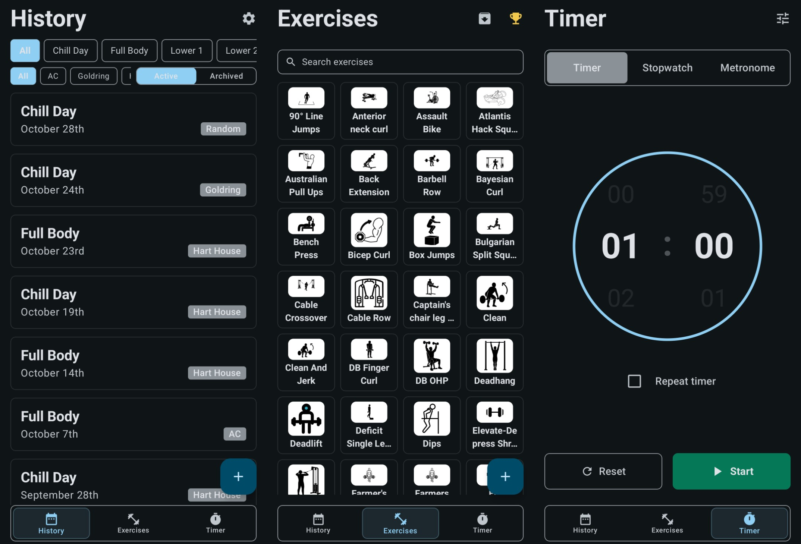
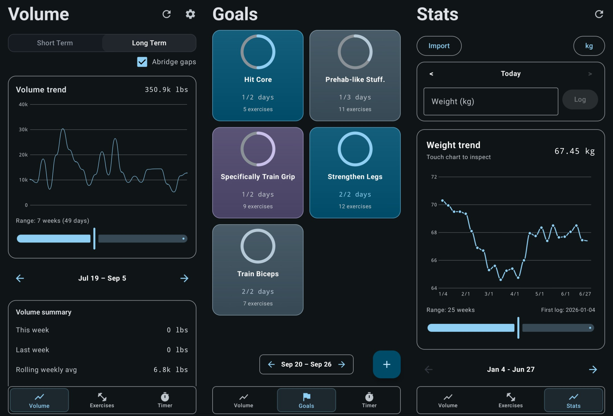

# Chiron

[](https://developer.android.com/about/versions/oreo)
[](https://developer.android.com/compose)
[](LICENSE)
[](https://github.com/intelligent-username/Chiron/releases/latest)

[Features](#features) · [Special features](#special-features) · [Build](#compilation--build) · [License](#license)


Chiron is a high-speed, customizable, and feature-rich workout tracker designed to eliminate the bloat, forced recommendations, rigid constraints, and invasive tracking found in modern fitness apps.

I built this app with Jetpack Compose and an offline-first Room architecture.

The app offers deep customization for traditional lifting, calisthenics, cadence training, and complex volume metrics, containing basically every feature that I personally need.

Download the latest version from the [releases tab](https://github.com/intelligent-username/Chiron/releases).

---

## Features

### The Three Core Tabs



#### 1. History

* Create, review, duplicate, and archive workouts.
* Add exercises and sets, including supersets.
  * Track by weight, time, reps, distance, and/or bodyweight.
* Edit workout details and open linked exercise records.
  * Keep track of the exact workout duration, including editing the start and end times.
  * Keep track of where you performed the workout, including editing the location retroactively.
* See the exact performance of an exercise from the last workout it was performed in.
* Link directly to exercise PRs

#### 2. Exercises

* Search, create, edit, and archive exercises.
* Configure wether the exericse is by weight, reps, time, distance, or bodyweight (including what percentage of bodyweight it uses).
* View personal records and exercise volume history.

#### 3. Timer

* Run a countdown timer with optional repeats and presets.
* Use a stopwatch with laps.
  * Track fastest/slowest lap times.
* Set a metronome tempo.
  * Set a custom cadence.
  * Choose 1 of 3 soudn effects.

### The Three Sub-tabs



Tap the title of each tab (at the top or bottom) to access its corresponding sub-tab. Tap again to switch back.

These tabs are just for 'add-on' tracking, things that you don't strictly need to exercise well, but are useful for broadly tacking your progress.

#### Volume

* View training volume by day or week.
* Adjust the range, navigate periods, and inspect chart points.
* View weekly, rolling, and all-time summaries.

#### Goals

* Create weekly activity goals linked to exercises.
* Review progress by day and week.
* Edit, archive, or delete goals.

#### Stats

* Log, edit, import, and delete bodyweight entries.
* View a weight trend and navigate date ranges.
* See current, average, lowest, and highest weight.

---

## Special Features

* Personal record tracking for exercises.
* Bodyweight percentages for exercise tracking.
* Spotify playback controls if you have the Spotify app installed and turn the setting on.
* Customizing earbuds actions when the metronome is on (example double tap to skip song, single tap to pause the metronome).
* ZIP backup export and import for app data and exercise assets.
* Bodyweight import from pasted text or a file.
* Weight and distance unit preferences.

---

## Compilation & Build

Now we get to building the app💪💪.

If you're a developer looking to customize it your steps, follow these instructions:


### Prerequisites
*   [JDK 17+](https://www.oracle.com/java/technologies/downloads/)
*   Android SDK 35 (compileSdk 35, minSdk 26)

### Debug Build
To assemble an unsigned debug APK:

```bash
.\gradlew.bat assembleDebug
```

The resulting APK will be located at:
`app\build\outputs\apk\debug\Chiron-debug.apk`

### Release Build
To assemble an optimized, minified release APK:

```bash
.\gradlew.bat assembleRelease
```

> **Note:** A valid `keystore.properties` file must be present in the project root to sign the release build. Refer to `keystore.properties.example` for required properties (`KEYSTORE_FILE`, `KEYSTORE_PASSWORD`, `KEY_ALIAS`, `KEY_PASSWORD`).

The resulting release APK will be located at:
`app\build\outputs\apk\release\Chiron-release.apk`

For OFFICIAL release binaries (built by me), visit the [GitHub Releases](https://github.com/intelligent-username/Chiron/releases) tab.

Note that you cannot download one of these official releases and then modify the source code and recompile it to get the same APK. In other words, if you download from the official release and make your own build, when you install your own build it will be a separate app from the official release, and you will not be updating the official release with your own build. As a result, you will have two copies of the app on your device that do not share any data.

This happens because the official release is signed with my private key for security reasons. However, if you do want to try this, you can simply build your own release anyway and then export your data from the official app and import it into your own build. You can also try submitting a [Pull Request](https://github.com/intelligent-username/Chiron/pulls) to the official GitHub if you want to contribute to the project :). 


---

## License

This project is licensed under the Apache 2.0 License.

 
